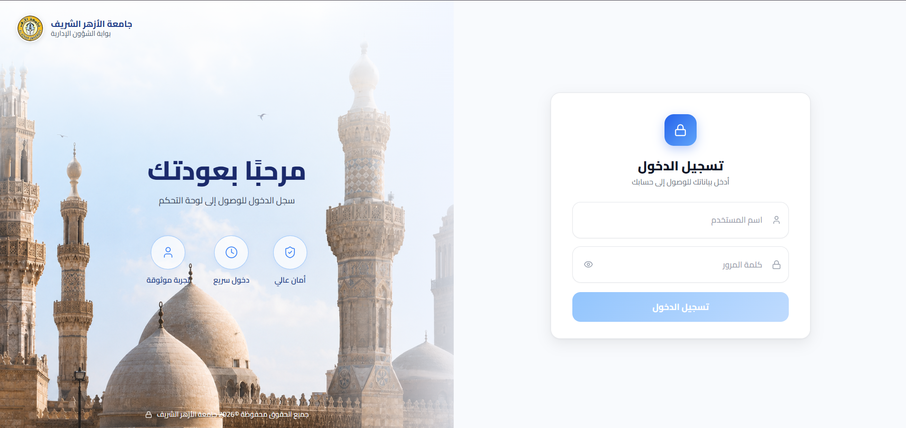

# 👋 Hi, I'm Ahmed Ragab Nafady

### 💻 Mid-Level Front-End Developer | React.js | Next.js | TypeScript

  

  
  

---

## 🚀 About Me

I'm a **Mid-Level Front-End Developer** passionate about building modern, scalable, and high-performance web applications.

I turn complex business requirements and Figma designs into responsive, maintainable, and user-friendly digital experiences. My work includes enterprise dashboards, multi-role management systems, and bilingual platforms.

- 💻 Specialized in **React.js, Next.js, JavaScript, and TypeScript**.
- 🏗️ Experienced in building complex admin dashboards and management systems.
- 🌍 Build bilingual interfaces with **Arabic RTL and English** support.
- 🔌 Experienced in REST API integration and data-driven applications.
- 🎨 Focused on reusable components, clean UI/UX, and maintainable code.
- ⚡ Interested in performance optimization and modern frontend architecture.

📍 Egypt

---

## 🛠️ Tech Stack & Tools

### Frontend Development

  

### Styling & UI

  

### State Management, Data Fetching & Libraries

  
  
  
  
  
  
  

### Tools

  

---

## 💼 Featured Projects

My work spans education, healthcare, and logistics platforms, including public-facing websites and administrative systems.

## 🎓 Al-Azhar University Portal

The university's public website and its dedicated administrative portal.

<table>
  <tr>
    <td width="50%" align="center" valign="top">
      
      <h4>🌐 University Website</h4>
      <a href="https://azhar-test.com/">Visit Website ↗</a>
    </td>
    <td width="50%" align="center" valign="top">
      
      <h4>⚙️ University Dashboard</h4>
      <a href="https://dashboard.azhar-test.com/">Visit Dashboard ↗</a>
    </td>
  </tr>
</table>

**Focus Areas:** University information · Administrative workflows · Role-based portals · Arabic RTL and English interfaces

---

## 🏆 Al-Azhar Ranking System

A separate platform focused on university rankings, evaluation, and ranking-related administration.

<table>
  <tr>
    <td width="50%" align="center" valign="top">
      
      <h4>🌐 Ranking Website</h4>
      <a href="https://azhar-ranking.com/">Visit Ranking Website ↗</a>
    </td>
    <td width="50%" align="center" valign="top">
      
      <h4>⚙️ Ranking Dashboard</h4>
      
Dashboard login preview

    </td>
  </tr>
</table>

**Focus Areas:** University rankings · Evaluation workflows · Accreditation · Ranking administration

---

## 🏢 Al-Azhar HR System

A dedicated HR system for human-resources administration.

  

  <a href="https://hr.roboeye-tec.com/">Visit HR System ↗</a>

---

## 🏥 ULMcare Healthcare Ecosystem

A digital healthcare ecosystem connecting patients, healthcare providers, and medical services through web platforms.

<table>
  <tr>
    <td width="50%" align="center" valign="top">
      
      <h4>🌐 ULMcare Website</h4>
      <a href="https://ulmcare.com/">Visit Website ↗</a>
    </td>
    <td width="50%" align="center" valign="top">
      
      <h4>⚙️ ULMcare Dashboard</h4>
      <a href="https://dashboard.ulmcare.com/">Visit Dashboard ↗</a>
    </td>
  </tr>
</table>

**Focus Areas:** Healthcare services · Medical providers · Booking and management · REST API integration · Responsive interfaces

### 🔹 ULM Connect

A connected digital platform for healthcare providers.

  

---

## 🚚 Paxi Logistics Platform

A digital platform for transportation, logistics, and delivery services.

<table>
  <tr>
    <td width="50%" align="center" valign="top">
      
      <h4>🌐 Paxi Website</h4>
      <a href="https://paxi.company/ar">Visit Website ↗</a>
    </td>
    <td width="50%" align="center" valign="top">
      
      <h4>⚙️ Paxi Dashboard</h4>
      
Dashboard login preview

    </td>
  </tr>
</table>

**Focus Areas:** Logistics · Transportation · Delivery operations · Driver and management interfaces

---

## 📊 GitHub Overview

  
  
  

### 🔥 Contribution Streak

  

### 💻 Explore My Code

  <a href="https://github.com/NAFADYY?tab=repositories">
    **View All My Repositories →**
  </a>

---

## 📈 Contribution Activity

  

  Building consistently • Learning continuously • Improving every day

---

## 🤝 Let's Connect

  
  
  
  

  <b>💡 Building meaningful digital experiences, one component at a time.</b>

  ⭐ Thanks for visiting my profile! Feel free to explore my repositories and connect with me.

