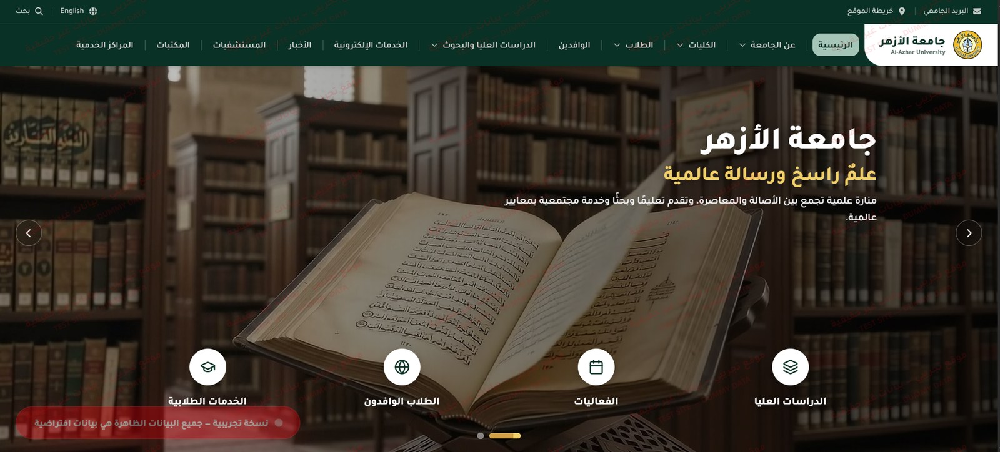
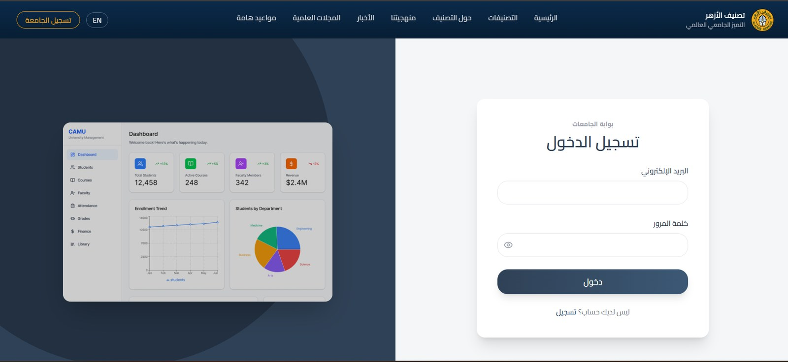
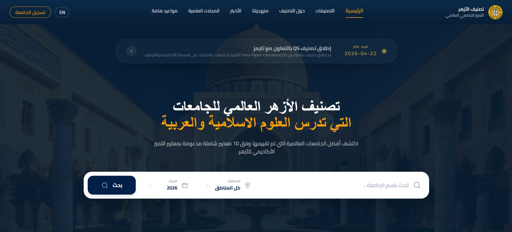
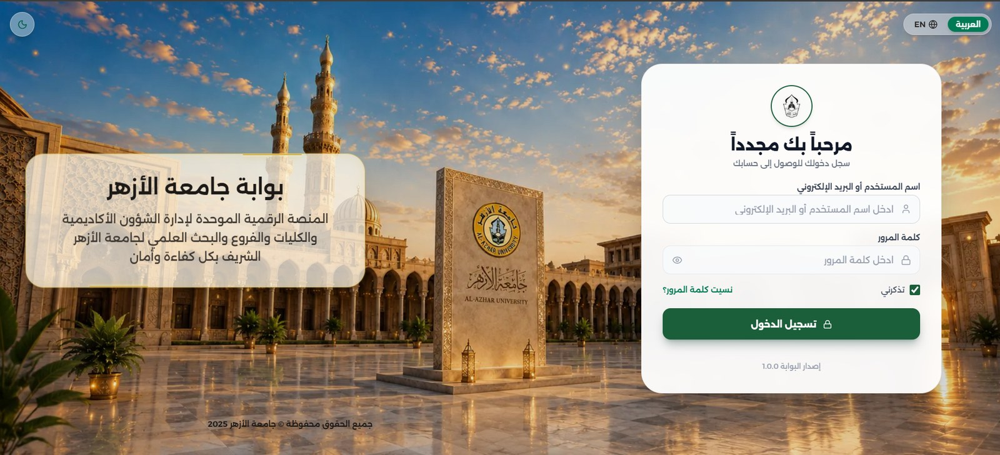
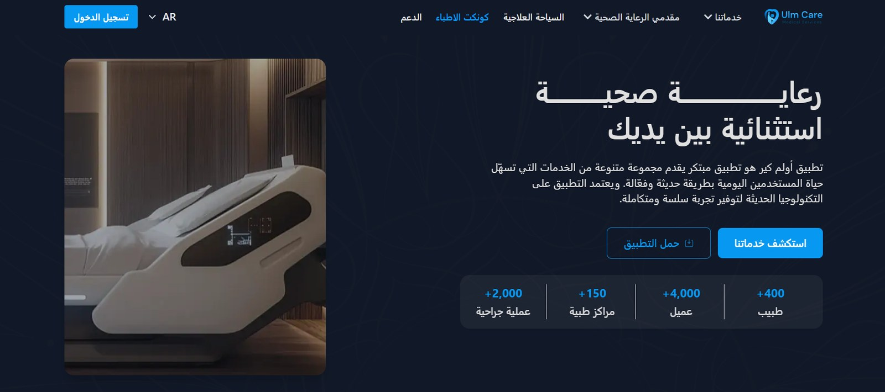
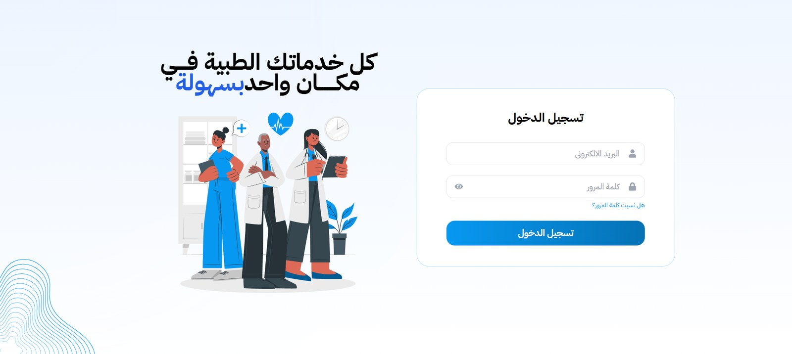
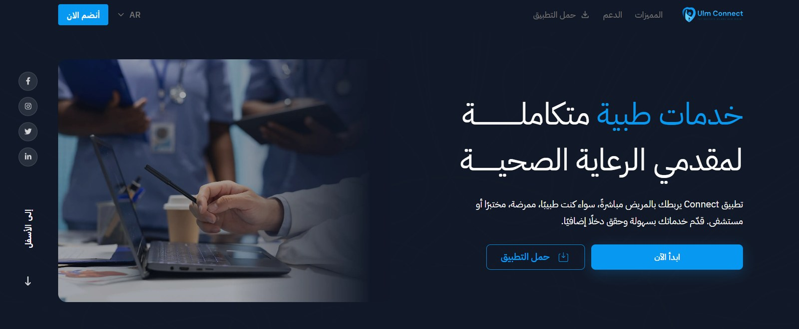
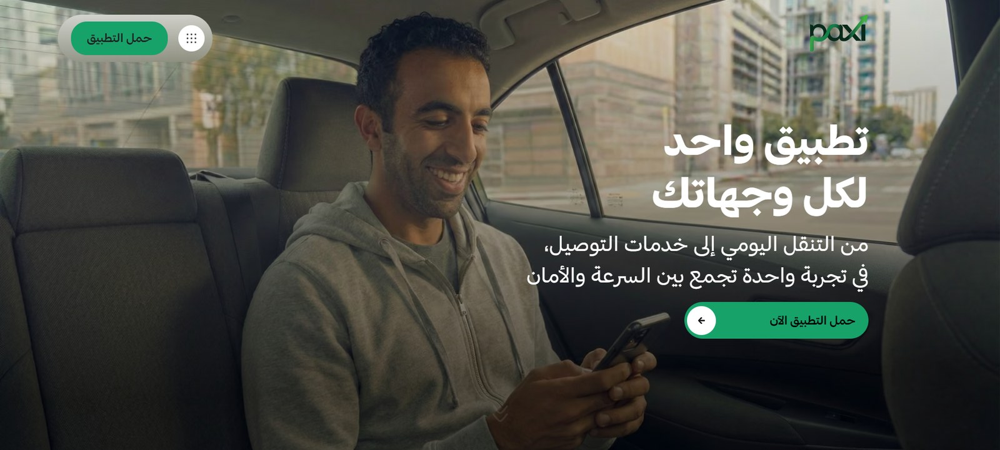
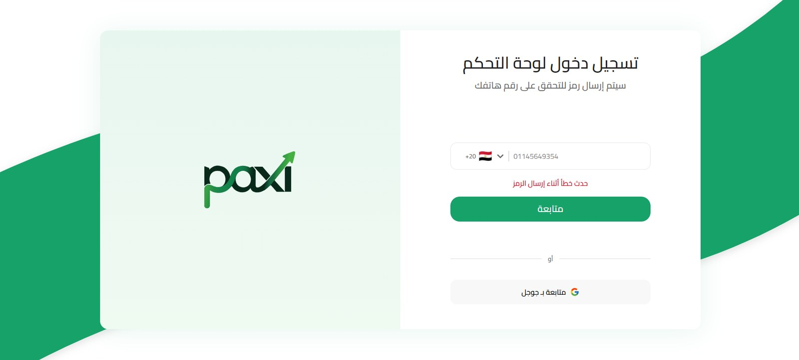

# 👋 Hi, I'm Ahmed Ragab Nafady

### 💻 Mid-Level Front-End Developer | React.js | Next.js | TypeScript

  

  
  

---

## 🚀 About Me

I'm a **Mid-Level Front-End Developer** passionate about building modern, scalable, and high-performance web applications.

I specialize in transforming complex business requirements and Figma designs into responsive, maintainable, and user-friendly digital experiences.

My experience includes developing enterprise-level dashboards, multi-role management systems, and bilingual platforms serving different business domains.

- 💻 Specialized in **React.js, Next.js, JavaScript, and TypeScript**.
- 🏗️ Experienced in building complex Admin Dashboards and Management Systems.
- 🌍 Experienced in bilingual applications with **Arabic RTL & English** support.
- 🔌 Skilled in REST API integration and data-driven applications.
- 🎨 Focused on clean UI/UX, reusable components, and maintainable architecture.
- ⚡ Interested in performance optimization and modern frontend practices.
- 🤝 Passionate about collaboration, problem-solving, and continuous learning.

📍 Egypt

---

## 🛠️ Tech Stack & Technologies

### Frontend Development

  

### Styling & UI Development

  

### State Management & Data Fetching

  

  
  
  
  
  
  

### Tools & Development

  

---

## 💼 Featured Projects

My work includes several large-scale digital platforms across education, healthcare, and logistics.

### 🎓 01. Al-Azhar Ranking Ecosystem

A comprehensive university ecosystem connecting the main university website, administrative portals, and global university ranking platform.

<table>
  <tr>
    <td width="50%" align="center" valign="top">
      
      <h4>🌐 Main University Website</h4>
      <a href="https://azhar-test.com/">Visit Website ↗</a>
    </td>
    <td width="50%" align="center" valign="top">
      
      <h4>⚙️ Admin Dashboard</h4>
      <a href="https://dashboard.azhar-test.com/">Visit Dashboard ↗</a>
    </td>
  </tr>
  <tr>
    <td colspan="2" align="center">
      
      <h4>🏆 Global University Ranking Platform</h4>
      <a href="https://azhar-ranking.com/">Explore Ranking Platform ↗</a>
    </td>
  </tr>
</table>

  
<b>Additional University Portal Preview</b>

   
  

    
  

**Key Features & Areas:**
- Multi-level Administrative Portals.
- Super Admin, University, Faculty & Branch Management.
- University Evaluation & Accreditation.
- Global University Ranking.
- Academic and Administrative Workflows.
- Bilingual Arabic & English Interfaces.

**Technologies:** React.js · JavaScript · Tailwind CSS · REST APIs · React Query

---

### 🏥 02. ULMcare Healthcare Ecosystem

A digital healthcare ecosystem designed to connect patients, healthcare providers, and medical services through modern web platforms.

<table>
  <tr>
    <td width="50%" align="center" valign="top">
      
      <h4>🌐 ULMcare Website</h4>
      <a href="https://ulmcare.com/">Visit Website ↗</a>
    </td>
    <td width="50%" align="center" valign="top">
      
      <h4>⚙️ ULMcare Dashboard</h4>
      <a href="https://dashboard.ulmcare.com/">Visit Dashboard ↗</a>
    </td>
  </tr>
</table>

**Key Features & Areas:**
- Healthcare Services & Management.
- Doctors, Hospitals & Medical Centers.
- Medical Booking and Service Interfaces.
- REST API Integration.
- Responsive and Bilingual Interfaces.

**Technologies:** React.js · JavaScript · React Query · Axios · REST APIs

#### 🔹 ULM Connect

A connected digital platform for healthcare providers.

  

---

### 🚚 03. Paxi Logistics Ecosystem

A digital platform focused on logistics, transportation, and delivery services.

<table>
  <tr>
    <td width="50%" align="center" valign="top">
      
      <h4>🌐 Paxi Website</h4>
      <a href="https://paxi.company/ar">Visit Website ↗</a>
    </td>
    <td width="50%" align="center" valign="top">
      
      <h4>⚙️ Paxi Dashboard</h4>
      
Dashboard Login Preview

    </td>
  </tr>
</table>

**Key Features & Areas:**
- Logistics & Transportation Management.
- Delivery Operations.
- Driver and Management Interfaces.
- Data-driven Dashboard Interfaces.
- Responsive Web Applications.

**Technologies:** React.js · JavaScript · REST APIs

---

## 📊 GitHub Statistics

  
  

### 🔥 Contribution Streak

  

---

## 🏆 GitHub Achievements

  

---

## 🤝 Let's Connect

I'm always open to discussing new opportunities, interesting projects, and collaborations.

  
  
  
  

---

  <b>💡 Building meaningful digital experiences, one component at a time.</b>

  ⭐ Thanks for visiting my profile! Feel free to explore my repositories and connect with me.

